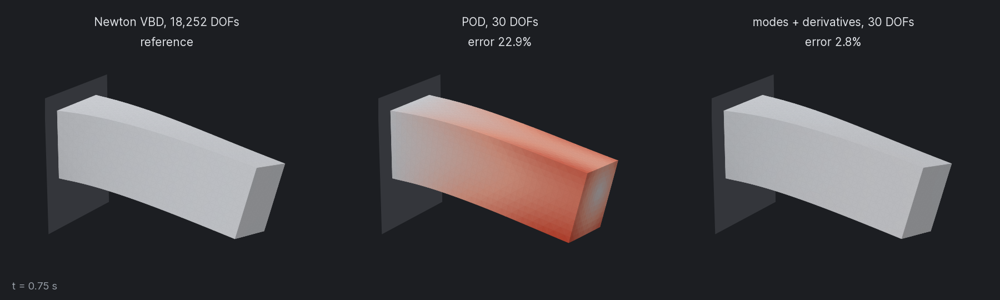

# newton-subspace

A reduced-order FEM solver for tetrahedral soft bodies in [newton physics](https://github.com/newton-physics/newton).

The mesh is restricted to `x = X + U q` with a fixed 30-column basis `U`, and each substep minimizes the
same backward Euler objective as Newton's `SolverVBD` (stable Neo-Hookean plus VBD's damping) over `q`.
The basis comes from vibration modes and modal derivatives (shift-invert Lanczos) or from full-order
snapshots (randomized SVD). A cubature rule evaluates a few hundred tets per step, so the cost doesn't
depend on mesh size.



## Results

1.2 m cantilever, 60 fps with 10 substeps, one H100. Error is the mass-weighted relative trajectory error
against a converged full-order run, on two loads that weren't in the training set.

| full DOFs | tets | VBD, 10 it (ms / err) | reduced (ms / mean / max err) | VBD at same error (it / ms) | speedup |
|---:|---:|---:|---:|---:|---:|
| 900 | 960 | 20.1 / 0.05% | 0.47 / 1.23% / 1.93% | 6 / 12 | 26x |
| 5,832 | 7,680 | 25.3 / 42% | 0.47 / 1.07% / 1.67% | 24 / 61 | 129x |
| 18,252 | 25,920 | 24.9 / 159% | 0.48 / 1.45% / 2.52% | 53 / 132 | 272x |
| 41,616 | 61,440 | 27.7 / 178% | 0.49 / 1.15% / 1.99% | 102 / 281 | 571x |
| 79,380 | 120,000 | 29.2 / 234% | 0.49 / 1.20% / 2.08% | 154 / 448 | 924x |

POD basis, r = 30, at most 400 cubature tets. On the twist test, which no training run covers, POD is
23% off and modes + modal derivatives are 1.2% off. More plots are in `docs/figures/`.

## Usage

```bash
conda create -p ./env python=3.11
./env/bin/pip install -r requirements.txt

# reduced beam next to a full-order VBD beam
./env/bin/python examples/example_reduced_cantilever.py --viewer gl --cubature 300
./env/bin/python examples/example_reduced_cantilever.py --viewer gl --basis pod --cubature 300
```

```python
from newton_subspace import SolverReducedFEM, TetMesh, modal_basis
from newton_subspace.cubature import fit_cubature

mesh = TetMesh.from_model(model)
U = modal_basis(mesh, 30, gravity_mode=True, modal_derivatives=True)
ids, w, _ = fit_cubature(mesh, U, Q, max_points=300, tol=1e-4)  # Q: training poses, reduced coords

solver = SolverReducedFEM(model, U, cubature=(ids, w))
for _ in range(10):
    solver.step(state, None, None, None, dt)
solver.write_state(state)
```

`scripts/run_all.sh` reruns the tests, experiments, figures and videos (about 4 hours on an H100).
Full-order references are cached in `results/cache/` (about 0.7 GB, not checked in).
Tested with Warp 1.18, Newton 1.7.0, CUDA 13.

## Layout

```
newton_subspace/
  solver.py        SolverReducedFEM, a newton.solvers.SolverBase
  basis.py         modes, modal derivatives, POD
  cubature.py      greedy NNLS cubature
  fem.py           mesh data and rest stiffness from a newton.Model
  full_newton.py   full-order Newton/PCG for reference solutions
  sim.py           load cases and graph-captured runners
  experiment.py    cached references and evaluation
examples/          interactive Newton example
scripts/           tests, experiments, figures, videos, web demo data
results/           experiment output (JSON)
docs/              project page; reduced_solver.js is a JS port of solver.py for the in-browser demo
```

`scripts/test_kernels.py` checks energy, stress and Hessian against float64 finite differences.
`scripts/test_correctness.py` runs the solver with a full basis, which makes it a plain Newton solver,
against converged `SolverVBD`. `node scripts/check_demo_js.mjs` compares the JS port to the Python one.

## References

- J. Barbič, D. James. Real-Time Subspace Integration for St. Venant-Kirchhoff Deformable Models. SIGGRAPH 2005.
- S. S. An, T. Kim, D. James. Optimizing Cubature for Efficient Integration of Subspace Deformations. SIGGRAPH Asia 2008.
- B. Smith, F. de Goes, T. Kim. Stable Neo-Hookean Flesh Simulation. ACM TOG 2018.
- N. Halko, P.-G. Martinsson, J. Tropp. Finding Structure with Randomness. SIAM Review 2011.
- A. H. Chen, Z. Liu, Y. Yang, C. Yuksel. Vertex Block Descent. SIGGRAPH 2024.
